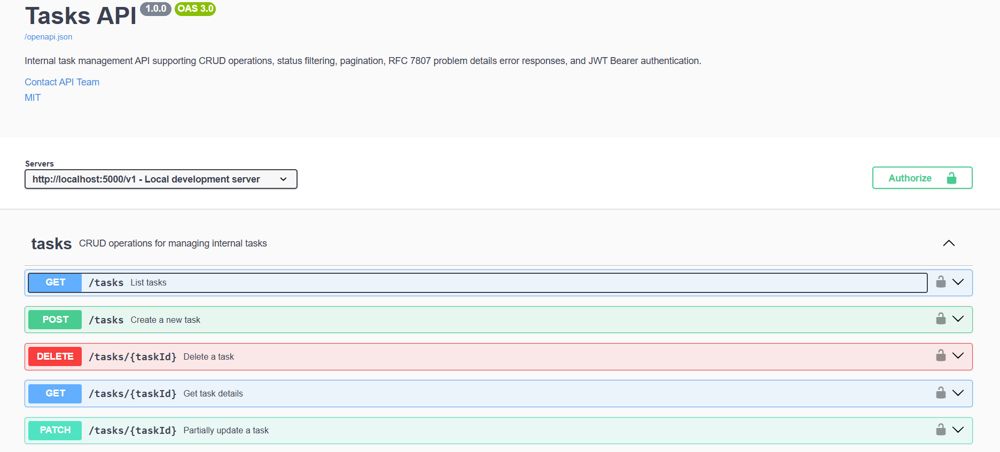
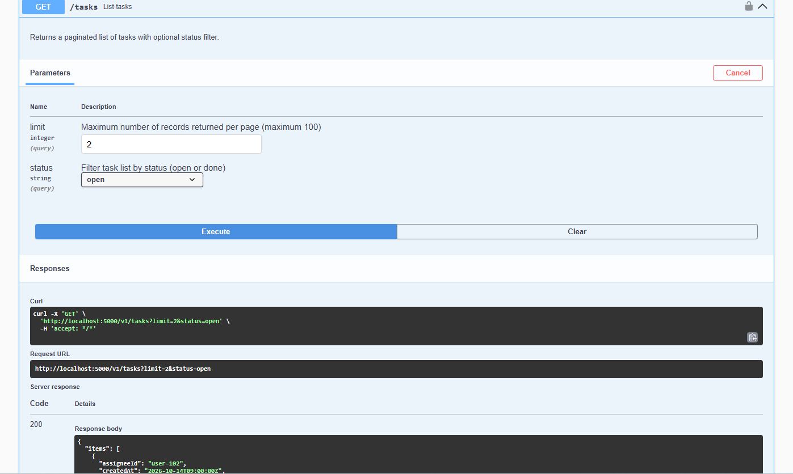
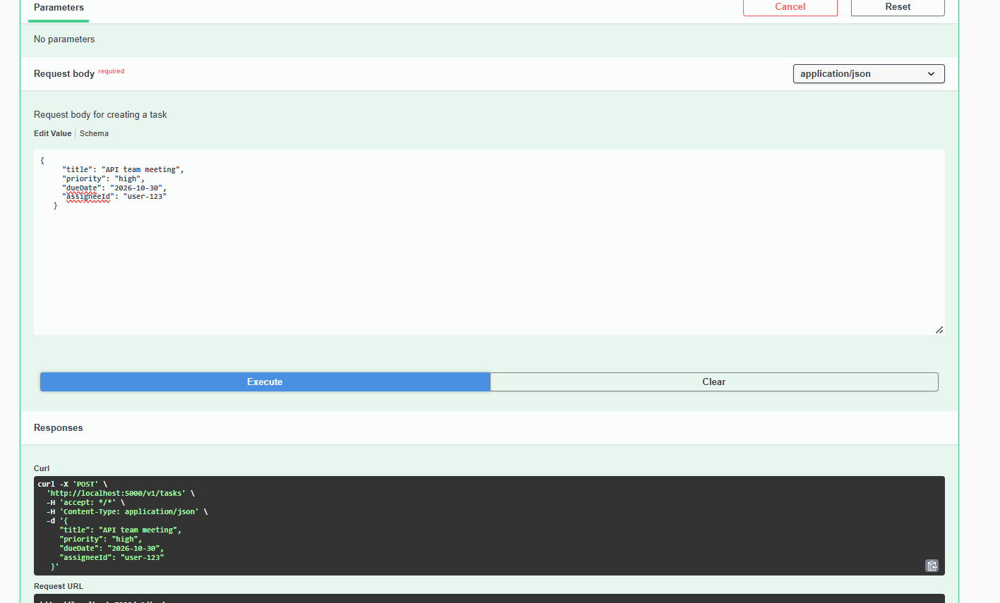
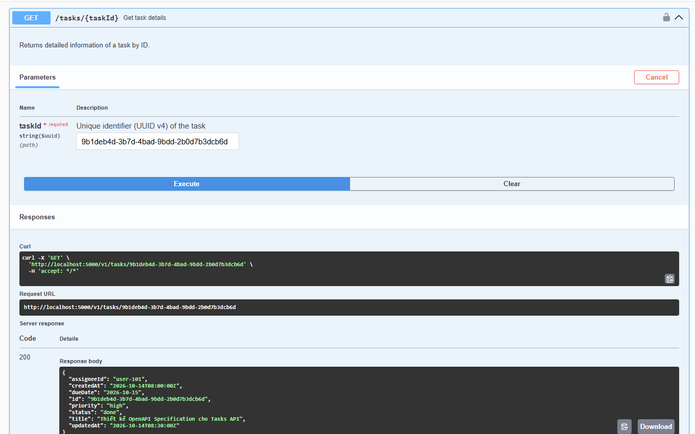
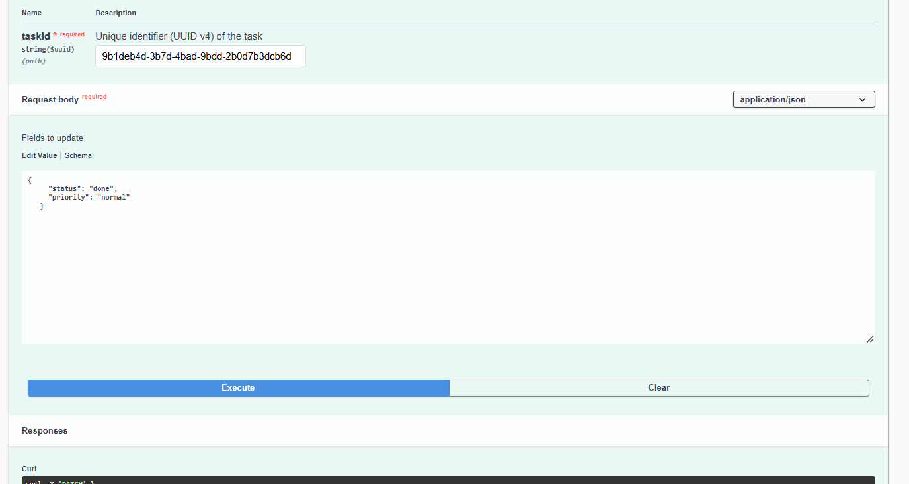
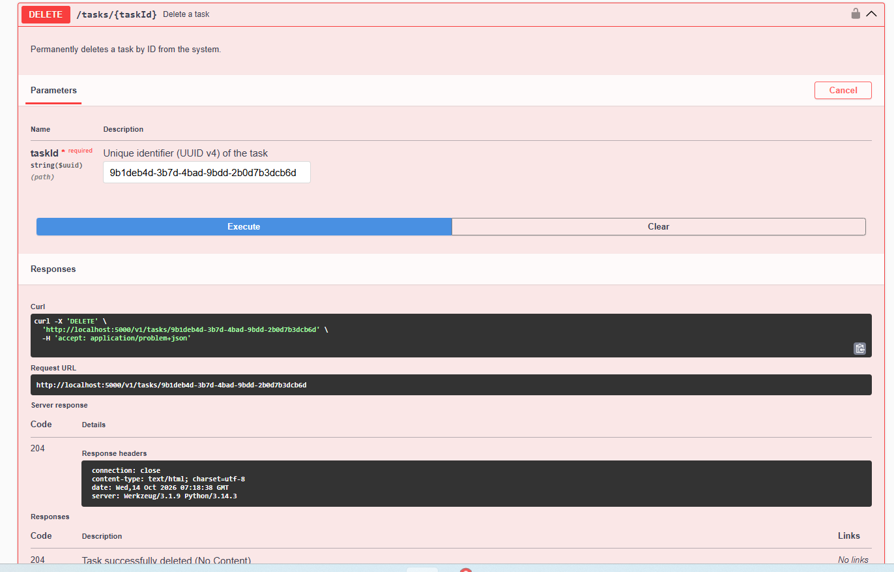

## Kiểm thử các endpoints với Swagger UI:

1. Giao diện Swagger UI hiển thị đầy đủ đặc tả OpenAPI 3.0 và 5 endpoints của Tasks API.

2. GET /tasks trả về 200 và danh sách các task (lọc status=open và phân trang limit=2).

3. POST /tasks tạo task mới thành công trả về 201 Created kèm header Location.

4. GET /tasks/{taskId} trả về 200 và thông tin chi tiết task theo ID.

5. PATCH /tasks/{taskId} cập nhật một phần dữ liệu task trả về 200.

6. DELETE /tasks/{taskId} xoá task theo ID trả về 204 No Content.
