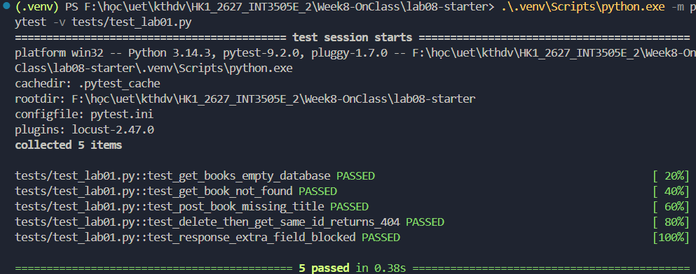
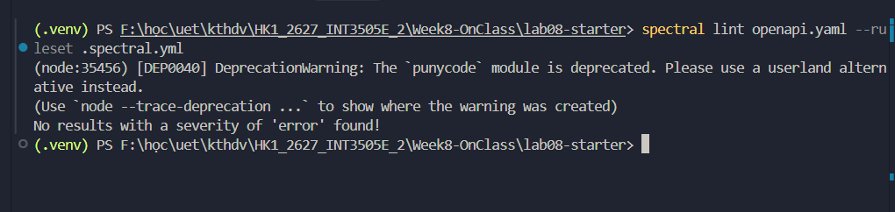

# lab08-starter — API Testing & Quality Assurance

**Flask 3.x / SQLAlchemy / pytest / OpenAPI / Postman / Locust**

## 1. Chuẩn bị và chạy API

Yêu cầu: Python **3.11+**; Node.js **18+** nếu chạy Newman/Spectral. Chạy từ thư mục gốc project.

```bash
python -m venv .venv
# Linux/macOS:
source .venv/bin/activate
# Windows PowerShell:
# .venv\Scripts\Activate.ps1
python -m pip install -r requirements.txt
python -m app --port 5000
```

API: `http://127.0.0.1:5000` (chỉ chạy trên máy local). Thử:

```bash
curl http://127.0.0.1:5000/health
curl http://127.0.0.1:5000/books
curl -X POST http://127.0.0.1:5000/books \
  -H 'Content-Type: application/json' \
  -d '{"title":"API Design Patterns","author":"J.J. Geewax","year":2021}'
```

SQLite lưu tại `instance/books.db` (không commit lên Git). API không có authentication bắt buộc cho CRUD để dễ thực hành functional test. `POST /auth/login` chỉ là **mô phỏng cục bộ**, tài khoản `lab/lab`; token không cấp quyền và **không được dùng trong production**.

### REST endpoints

| Method | Path | Trả về |
|---|---|---|
| GET | `/health` | 200 |
| GET | `/books?author=&year=&page=` | 200, JSON array, page 1-based, 20 items/page |
| GET | `/books/{id}` | 200 / 400 (ID sai định dạng) / 404 |
| POST | `/books` | 201 / 400 / 409 (ISBN trùng) |
| PUT | `/books/{id}` | 200 / 400 / 404 / 409 |
| DELETE | `/books/{id}` | 204 (không body) / 400 / 404 |
| POST | `/auth/login` | 200 / 401, chỉ để minh họa |

Schema JSON của Book trả `id`, `title`, `author`, `year`, `isbn`. Trong request, `title` và `author` là required. `year`/`isbn` tùy chọn; ISBN nếu có là 13 chữ số và unique. **POST lặp lại chỉ 409 nếu xảy ra xung đột ISBN**, không phải vì lặp payload nói chung. DELETE lần đầu 204, lần sau 404; điều này không mâu thuẫn với idempotency vì trạng thái tài nguyên sau hai lần là như nhau.

## 2. Lab 1 — pytest

```bash
python -m pytest -v tests/test_lab01.py
```

Hai smoke test có sẵn nhằm xác nhận starter hoạt động. Hãy viết **4 test bắt buộc + 1 bonus** trong `tests/test_lab01.py`, theo các TODO trong file. Fixture `app`, `client`, `sample_book` ở `tests/conftest.py`; dùng `get_book_schema()` từ `tools.py` khi cần. Mỗi test có DB riêng, không phụ thuộc thứ tự. Lưu ý: schema Book trong `openapi.yaml` **đang cố ý sai ở trường year** cho Lab 2; muốn validate response mẫu có `year`, cần hoàn thành sửa lỗi đó trước.

### Kết quả kiểm thử Lab 1



- **Test A (`test_get_books_empty_database`)**: `GET /books` khi DB rỗng trả về mảng `[]` (không phải `null`).
- **Test B (`test_get_book_not_found`)**: `GET /books/9999` trả về 404 và JSON `code: "NOT_FOUND"`.
- **Test C (`test_post_book_missing_title`)**: `POST /books` thiếu title trả về 400 và `errors` có chứa trường `title`.
- **Test D (`test_delete_then_get_same_id_returns_404`)**: Tạo mới, xóa rồi GET lại cùng id trả về 404.
- **Test Bonus (`test_response_extra_field_blocked`)**: Dùng `jsonschema` kiểm chứng backend không để lộ trường `password_hash`, đồng thời bắt lỗi `ValidationError` khi response copy chứa trường lạ.

## 3. Lab 2 — OpenAPI/Spectral

Ba lỗi **cố ý** trong `openapi.yaml`:

1. `GET /books` thiếu `operationId`.
2. Response `DELETE /books/{id}` HTTP 204 có `content` dù không được có response body.
3. `Book.year` khai báo `type: string` thay vì kiểu của model Python.

```bash
npm install -g @stoplight/spectral-cli
spectral lint openapi.yaml --ruleset .spectral.yml
```

`.spectral.yml` đã có hai rule riêng kiểm tra (2) và (3); `spectral:oas` kiểm tra các quy tắc nền, bao gồm operationId. Hãy sửa 3 lỗi trong spec và **tự bổ sung custom rule** kiểm tra response 200 có schema không rỗng. Lưu ý: Spectral linter không tự đối chiếu code Flask; một spec hợp lệ vẫn có thể khác hành vi thực tế. Hãy dùng pytest + jsonschema để kiểm chứng response.
### Kết quả kiểm thử Lab 2


## 4. Lab 3 — Postman/Newman

File `books-api.postman_collection.json` gồm 2 folder:
- `books/` — 5 happy-path requests theo thứ tự: list → create → get → update → delete. Request create lưu `book_id` vào **collection variable**; GET/PUT/DELETE dùng lại `{{book_id}}`.
- `error-cases/` — 2 error request, mỗi request ≥2 `pm.test` (status + body):
  - **POST /books** thiếu `title` → 400, `code == "VALIDATION_ERROR"`, `errors` chứa field `title`.
  - **GET /books/9999** → 404, `code == "NOT_FOUND"`, `message == "Book not found"`.

### Cách chạy (không cần Postman UI)

Nhanh nhất — script tự bật Flask, chờ `/health`, chạy Newman rồi tắt Flask:

```bash
bash run_lab3.sh
```

Hoặc chạy thủ công (cần Node 18+ và venv đã cài deps):

```bash
mkdir -p instance                       # thư mục SQLite (gitignored)
python -m app --port 5000 &             # terminal 1: bật API
npm install -g newman                   # hoặc thay bằng: npx --yes newman ...
newman run books-api.postman_collection.json \
  -e postman/local.postman_environment.json \
  -r cli,junit --reporter-junit-export reports/junit.xml
```

### Kết quả kiểm thử Lab 3

Newman chạy 7 request (5 happy + 2 error), 16 assertion, 0 fail, tổng ~0.4s (<10s). JUnit: `reports/junit.xml` (7 testsuite / 16 testcase). Log CLI: `reports/newman-lab3.log`.

Lưu ý: `data.csv` là dữ liệu ví dụ để thực hành data-driven iteration; khi dùng `-d data.csv`, collection lặp theo số hàng. Đừng hard-code credentials/tokens trong file đẩy lên Git.

## 5. Lab 4 — Locust

`performance/locustfile.py` là baseline có weighted tasks; `performance/locustfile_realistic.py` minh hoạ flow có state và demo login. Chạy API trong terminal 1; terminal 2:

```bash
mkdir -p reports
locust -f performance/locustfile.py --headless -H http://127.0.0.1:5000 \
  -u 10 -r 2 -t 30s --html reports/A.html
locust -f performance/locustfile.py --headless -H http://127.0.0.1:5000 \
  -u 50 -r 5 -t 60s --html reports/B.html
locust -f performance/locustfile.py --headless -H http://127.0.0.1:5000 \
  -u 200 -r 50 -t 30s --html reports/C.html
```

Hoàn thiện TODO `search_by_year` và nếu tạo 1% failure giả lập, **ghi rõ** đó là HTTP 500 do server phát hay client-side `response.failure()` của Locust. Điền `performance/analysis.md` bằng kết quả **đo thực tế**; báo cáo p95, failure rate, RPS, nhận xét giới hạn phép đo. Load test chạy Flask development server + SQLite chỉ có ý nghĩa thực hành, không thể khẳng định SLO production.

## 6. Cấu trúc thư mục

```text
lab08-starter/
├── app.py, models.py, tools.py
├── openapi.yaml, .spectral.yml
├── books-api.postman_collection.json
├── data.csv, requirements.txt, pytest.ini
├── tests/
│   ├── conftest.py
│   ├── test_smoke.py             # supplied baseline
│   └── test_lab01.py             # student TODO
├── postman/
│   ├── books-api.postman_collection.json
│   └── local.postman_environment.json
├── performance/
│   ├── locustfile.py
│   ├── locustfile_realistic.py
│   └── analysis.md
├── reports/
└── .github/workflows/tests.yml
```

## Lưu ý:

- OpenAPI cố ý chứa lỗi nên các công cụ contract check phải fail **trước khi sửa**.
- `pytest` và Newman đều chạy được độc lập sau khi đã cài dependency, không cần Postman GUI.
